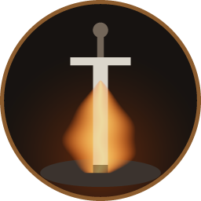
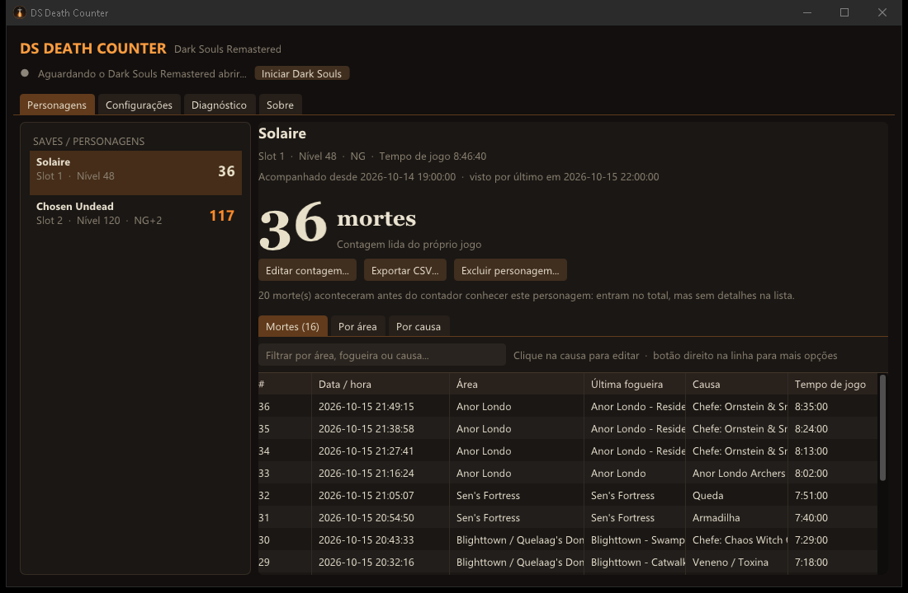

<p align="center">
  
</p>

<h1 align="center">DS Death Counter</h1>

<p align="center">
  Contador de mortes automático, com overlay na tela, para <b>Dark Souls Remastered</b>, <b>Dark Souls II: Scholar of the First Sin</b>, <b>Sekiro: Shadows Die Twice</b>, <b>Bloodborne</b> (port de PC, experimental) e <b>Hollow Knight</b>.<br>
  Para streamers e para quem quer saber quantas vezes (e onde) morreu.
</p>

<p align="center">
  <a href="https://github.com/Theuzin69/ds-death-counter/releases/latest"></a>
  <a href="https://github.com/Theuzin69/ds-death-counter/releases"></a>
  <a href="LICENSE"></a>
  <a href="docs/como-foi-feito.md"></a>
  
</p>

<p align="center">
  <a href="README.md">English</a> · <b>Português (Brasil)</b>
</p>

<p align="center">
  
</p>

> [!IMPORTANT]
> **Este app foi feito com IA.** O código, a pesquisa dos endereços de memória e esta documentação foram escritos pelo **Claude** (modelo *Claude Opus 5.5*, da Anthropic, usado pelo *Claude Code*), com direção e testes no jogo de **MatheusMuzzi**.
> A história completa, incluindo o que foi verificado e como, está em **[Como foi feito](docs/como-foi-feito.md)**.

## Recursos

- **Conta as mortes sozinho.** Lê o contador de mortes que o próprio jogo guarda para cada personagem; você não precisa apertar nada enquanto joga. (O Hollow Knight não guarda contador, então nele o próprio app conta cada morte.)
- **Uma contagem para cada save/personagem**, cada uma com o seu histórico.
- **Nunca perde a contagem.** Fechou o jogo, a contagem para; abriu de novo, continua de onde parou. Mortes que acontecerem com o contador fechado também entram.
- **Overlay por cima do jogo**, com fonte, tamanho, canto, cores e contorno à sua escolha. `Ctrl+Shift+D` mostra/oculta.
- **Lista de todas as mortes**: data/hora, área (mapa), última fogueira (no Sekiro, a área do último Ídolo do Escultor; no Hollow Knight, a do último banco), causa e tempo de jogo. Estatísticas por área e por causa, e exportação para CSV.
- **Fonte de texto para o OBS, para quem faz live.** Se quiser, grava a contagem num arquivo de texto que uma fonte **Texto (GDI+)** do OBS lê, então funciona com Captura de jogo e Captura de janela. Você escolhe o texto, ex.: `Mortes: {mortes}` ([como configurar](docs/guia-do-usuario.md#7-lives-obs)).
- **Chefes e quedas são detectados automaticamente.** No Dark Souls Remastered, morreu com a barra de vida de um chefe na tela, a causa é aquele chefe; nos Dark Souls, perdeu muita altura logo antes de morrer, é queda. Para as outras causas, escolha nas sugestões (inimigos, armadilhas…) com um clique.
- **Contagem editável.** Quando editada, ela fica marcada no app e o número do overlay muda de cor.
- **Fica quietinho na bandeja** e pode iniciar com o Windows: abriu o jogo, já está contando.
- **Somente leitura.** Nunca escreve no jogo, não injeta nada e não mexe nos seus saves (veja [É seguro?](#é-seguro-posso-tomar-ban)).
- Um único executável de ~1 MB, sem nada extra para instalar.

## Download

Na página de **[Releases](https://github.com/Theuzin69/ds-death-counter/releases/latest)**, baixe um destes:

| Arquivo | O que é |
|---|---|
| `DSDeathCounter-Setup-x.y.z.exe` | **Instalador (recomendado).** Instala só para o seu usuário (sem pedir administrador), cria atalho no menu Iniciar, pode iniciar com o Windows e tem desinstalador. |
| `DSDeathCounter-x.y.z-portable.zip` | **Portátil.** Descompacte onde quiser e abra o `DSDeathCounter.exe`. |
| `SHA256SUMS.txt` | Somas de verificação dos arquivos. |
| Source code (zip / tar.gz) | Código-fonte, adicionado automaticamente pelo GitHub. |

<a id="smartscreen"></a>

## ⚠️ O Windows vai mostrar um aviso na primeira vez (é normal)

O DS Death Counter **não tem assinatura digital**. Um certificado de assinatura de código custa centenas de dólares por ano, o que não faz sentido para um projeto gratuito. Por isso, na primeira vez que você abrir o instalador (ou o exe), o Windows provavelmente vai mostrar:

> **O Windows protegeu o computador**
> O Microsoft Defender SmartScreen impediu a inicialização de um aplicativo não reconhecido. A execução desse aplicativo pode pôr o seu computador em risco.
> *Editor: Editor desconhecido*

Para continuar, clique em **Mais informações** e depois em **Executar assim mesmo**.

<details>
<summary><b>Por que isso acontece, e como conferir que o arquivo é o verdadeiro?</b></summary>

O SmartScreen avisa sobre **qualquer** arquivo novo que não tenha assinatura e que ainda tenha sido baixado por pouca gente. Não é uma detecção de vírus. O navegador também pode avisar ("não é baixado com frequência"). No Edge, use **⋯ > Manter**; no Chrome, **Manter**.

Para ter certeza de que o arquivo é o verdadeiro:

1. Baixe **somente** da página de [Releases](https://github.com/Theuzin69/ds-death-counter/releases) deste repositório.
2. Os arquivos dos releases são **compilados automaticamente pelo GitHub Actions** a partir do código público, e os [registros dessas compilações](https://github.com/Theuzin69/ds-death-counter/actions) são públicos.
3. Compare a soma de verificação com o `SHA256SUMS.txt` do release:
   ```powershell
   Get-FileHash .\DSDeathCounter-Setup-1.0.0.exe -Algorithm SHA256
   ```
4. Confira a procedência da compilação (prova que o arquivo saiu do processo automático deste repositório) com o [GitHub CLI](https://cli.github.com/):
   ```powershell
   gh attestation verify .\DSDeathCounter-Setup-1.0.0.exe --repo Theuzin69/ds-death-counter
   ```
5. Se quiser, envie o arquivo ao [VirusTotal](https://www.virustotal.com/).

Alguns antivírus também podem desconfiar do app só por ele ler a memória de outro programa, que é justamente como ele conta as mortes. Ele apenas **lê**.
</details>

## Começando

1. Instale (ou descompacte) e abra o **DS Death Counter**. Conte com o [aviso do SmartScreen](#smartscreen) acima.
2. Na tela de boas-vindas, deixe ele achar o jogo (ou aponte o `DarkSoulsRemastered.exe`) e mantenha marcado **Iniciar com o Windows**. Os outros jogos não precisam de configuração: cada um é reconhecido sempre que estiver aberto.
3. Deixe o jogo em modo **Janela** (ou janela sem bordas). Em tela cheia exclusiva o overlay pode não aparecer. Em *Configurações › Janela do jogo* há um botão que tira a borda da janela do jogo, e fica igual a tela cheia.
4. Carregue um personagem e jogue. A contagem aparece no canto do jogo e cada morte vai para a lista.

O **[Guia do usuário](docs/guia-do-usuario.md)** explica cada tela e opção, dicas para OBS e lives, backup e solução de problemas.

## É seguro? Posso tomar ban?

O contador foi feito para ficar longe de tudo que poderia marcar sua conta:

- **Só lê** a memória do jogo (`ReadProcessMemory`), a mesma técnica usada há anos pelos autosplitters do LiveSplit e pelo DSDeaths. O processo do jogo é aberto apenas com permissão de leitura.
- **Nunca escreve** no jogo, **não injeta DLL**, **não instala hooks** e não altera arquivos nem saves.
- O overlay é uma **janela separada** por cima do jogo; nada é desenhado dentro dele.
- Editar a contagem só muda o número guardado por este app. O contador do próprio jogo nunca é tocado.
- Os banimentos do Dark Souls (o "soft ban") vêm de dados de personagem impossíveis enviados aos servidores, coisa que este app não toca. O Sekiro e o Hollow Knight nem têm modo online.

Nenhuma ferramenta de terceiros pode prometer risco zero com honestidade, mas ler a memória sem modificar nada é o cenário mais seguro possível.

## Compatibilidade

| | |
|---|---|
| Windows | 10 ou 11, 64 bits |
| Dark Souls Remastered | Funciona na versão original 1.01 e nas versões 1.03.x (a atual da Steam). A versão do jogo é detectada automaticamente. |
| Dark Souls II | **Scholar of the First Sin** (64 bits), desde a 1.1.0. Conferido no executável 1.02; a versão atual da Steam (1.03) é encontrada pelas mesmas assinaturas de bytes, mas ainda não foi confirmada no jogo. O Dark Souls II original de 32 bits (2014) **não** é suportado: o app avisa em vez de contar. |
| Sekiro: Shadows Die Twice | **1.06** (a versão atual da Steam), conferida no executável do jogo. O app lê a organização da memória do próprio código do jogo, então as versões anteriores (1.02 a 1.05) provavelmente funcionam, mas não foram testadas. Conta **só as mortes de verdade**: ressuscitar não conta (veja o [guia do usuário](docs/guia-do-usuario.md#sekiro)). O Sekiro não tem nome de personagem, então cada slot de save é um personagem. |
| Bloodborne | **Experimental.** O Bloodborne PC Windows port v0.5 (`bbport.exe`) rodando o Bloodborne 1.09: mortes, nome, nível, NG+ e tempo de jogo. Ainda sem área nem detecção de quedas, e ainda não confirmado numa sessão de jogo de verdade. Veja o [guia do usuário](docs/guia-do-usuario.md#bloodborne-port-de-pc-experimental). |
| Hollow Knight | A versão atual da Steam (Unity 6, 2026), lida pelo runtime Mono do jogo, pelo nome das classes e dos campos. O jogo **não tem contador de mortes**, então o app conta cada morte enquanto está aberto, por slot de save (saves Steel Soul ficam separados); mortes em sonhos e no Godhome também contam, um espinho que só tira uma máscara não. Registra a área, a área do último banco e o chefe da arena. Ainda não confirmado no jogo. Versões antigas (1.4.3.2 e anteriores) não são suportadas. Veja o [guia do usuário](docs/guia-do-usuario.md#hollow-knight). |
| Modo de tela | Janela / janela sem bordas. Em tela cheia exclusiva o overlay pode não aparecer. |
| Idioma do app | Português do Brasil (inglês planejado) |

Se algo parecer errado, abra a aba **Diagnóstico**, clique em **Copiar** e cole num [relato de bug](https://github.com/Theuzin69/ds-death-counter/issues/new/choose).

## Documentação

- [Guia do usuário](docs/guia-do-usuario.md) · [User guide (EN)](docs/user-guide.md)
- [Como foi feito (uso de IA)](docs/como-foi-feito.md) · [How it was made (EN)](docs/how-it-was-made.md)
- [Histórico de versões](CHANGELOG.md)
- [Como contribuir / compilar](CONTRIBUTING.md)

## Compilando

Precisa do Visual Studio 2019/2022 com *Desenvolvimento para desktop com C++* (ou as Build Tools).

```bat
build.bat
```

Gera `build\DSDeathCounter.exe`, com tudo embutido (sem DLLs extras). Testes, instalador e publicação de versões estão no [CONTRIBUTING.md](CONTRIBUTING.md).

## Créditos

- Ideia, requisitos e testes no jogo: **MatheusMuzzi**
- Código, engenharia reversa e documentação: **Claude** (Anthropic), via Claude Code. Veja [Como foi feito](docs/como-foi-feito.md).
- Os endereços de memória e assinaturas partem da pesquisa pública da comunidade: [DSDeaths](https://github.com/quidrex/DSDeaths), [SoulSplitter](https://github.com/FrankvdStam/SoulSplitter), [DSR-Gadget](https://github.com/JKAnderson/DSR-Gadget), [DS-Gadget](https://github.com/JKAnderson/DS-Gadget) e [DS2S-META](https://github.com/Nordgaren/DS2S-META).
- Bibliotecas: [Dear ImGui](https://github.com/ocornut/imgui) e [nlohmann/json](https://github.com/nlohmann/json), ambas MIT. Veja [THIRD_PARTY_NOTICES.md](THIRD_PARTY_NOTICES.md).

## Licença

[MIT](LICENSE) © 2026 MatheusMuzzi

*DARK SOULS é marca registrada da BANDAI NAMCO Entertainment Inc. / FromSoftware, Inc. SEKIRO: SHADOWS DIE TWICE é marca registrada da FromSoftware, Inc. BLOODBORNE é marca registrada da Sony Interactive Entertainment LLC. HOLLOW KNIGHT é marca registrada da Team Cherry. O DS Death Counter é uma ferramenta feita por fãs, sem nenhum vínculo, aprovação ou patrocínio de nenhuma delas.*
